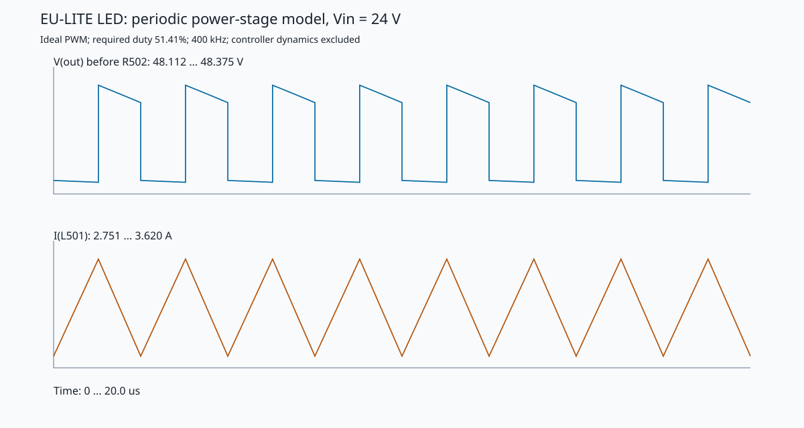

# LED boost — периодическая модель силового каскада

Источник: `design.json` SHA-256 `66fbe04017d0`.
Расчёт: `tools/led_boost_simulation.py`; стандартная библиотека Python.

| Режим | Vin, В | Требуемый duty, % | Заданный ILED, А | PLED, Вт | Пик L501, А | Пик IS, мВ | Vout p-p, мВ |
| --- | ---: | ---: | ---: | ---: | ---: | ---: | ---: |
| low_line | 21.6 | 56.41 | 1.548 | 74.3 | 3.895 | 157.4 | 233 |
| nominal | 24.0 | 51.41 | 1.548 | 74.3 | 3.536 | 142.8 | 212 |
| high_line | 25.0 | 49.34 | 1.548 | 74.3 | 3.405 | 137.6 | 204 |
| low_line_tolerance | 21.6 | 56.45 | 1.627 | 78.1 | 4.081 | 164.9 | 244 |

Нагрузка соответствует 48 В на LED после R502. Установившийся duty подобран
к заданному току; совпадение ILED с уставкой является условием расчёта и
**не подтверждает работу реального регулятора**. Пики L501 рассчитаны без
ограничителя тока. Наибольший пик модели 4.081 А сравнивается со
справочным минимумом IS 5.322 А и не заменяет более
консервативный расчёт `verify.py` с КПД 90% и допусками.

## Метод и численная проверка

Два состояния: ток L501 и напряжение идеальной части выходного конденсатора.
Отдельно интегрируются фазы включённого ключа и проводящего диода (RK4);
периодическое состояние решается из линейного отображения полного периода.
Петля COMP, алгоритм PRO и защитные компараторы LM3429 не моделируются.

Проверены непрерывный ток (CCM), возврат состояния за период, баланс
`Pin = PLED + потери модели`, точность заданной рабочей точки и уменьшение
шага примерно с 25 до 12,5 нс. Для всех четырёх режимов изменение Vout,
пульсаций, пикового тока и входной мощности при уточнении шага меньше 0,2%.
Основной отчёт использует уточнённый шаг; подробные ошибки есть в JSON.

## Принятые параметры

- Частота 400 кГц — предположение из расчёта проекта; цепь RCT не симулируется.
- L501 43,5 мкГн, DCR 30 мОм (DCR принят, физически не измерен).
- Q501: 20,8 мОм при 4,5 В из таблицы проекта; температурный рост,
  заряд затвора и потери переключения не включены.
- D501: приближение 0,60 В + 20 мОм.
- R501: 40,4 мОм (+1%). R502: 150 мОм; в углу верхнего тока — 148,5 мОм.
- C508/C509…C515: 498,3 мкФ, суммарный условный ESR 60 мОм;
  DC-bias керамики и отдельные ветви ESR/ESL не характеризованы.
- LED — один резистивный эквивалент `48 В / заданный ток`, после R502.
  Все J501/J502/J503 представлены одной суммарной нагрузкой.
- Верхний ток получен из VCSH 1,26 В и допусков 1% R503/R505/R506/R502.
  Справочные IS 215 мВ и OVP 1,24 В взяты из [TI LM3429 Rev. H](https://www.ti.com/lit/ds/symlink/lm3429.pdf).
  Номинальный порог OVP делителя: 54.56 В; допуски OVP здесь не исследованы.

## Практический предел результата

Это начальная модель силового каскада с идеальным PWM, без SPICE-макромоделей
производителей. Она даёт ток и пульсации в заданной рабочей точке.
Пуск, минимальная яркость nDIM, устойчивость COMP, работа OVP/КЗ, EMI,
паразитные выбросы, нагрев и деление тока LED-ветвей остаются стендовыми
вопросами. КПД модели нельзя использовать как прогноз КПД платы:
потери переключения и сердечника отсутствуют.

Повторить расчёт и проверить актуальность результатов:

```powershell
& 'C:\Program Files\KiCad\10.0\bin\python.exe' hardware/PCB_EU_LITE/tools/led_boost_simulation.py --check
```


