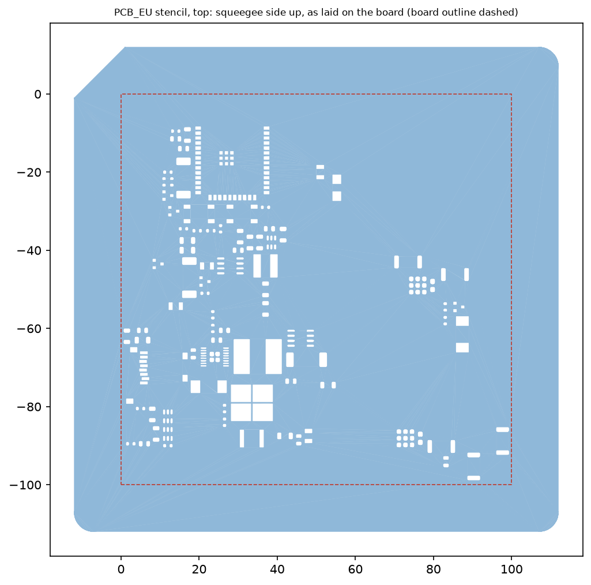
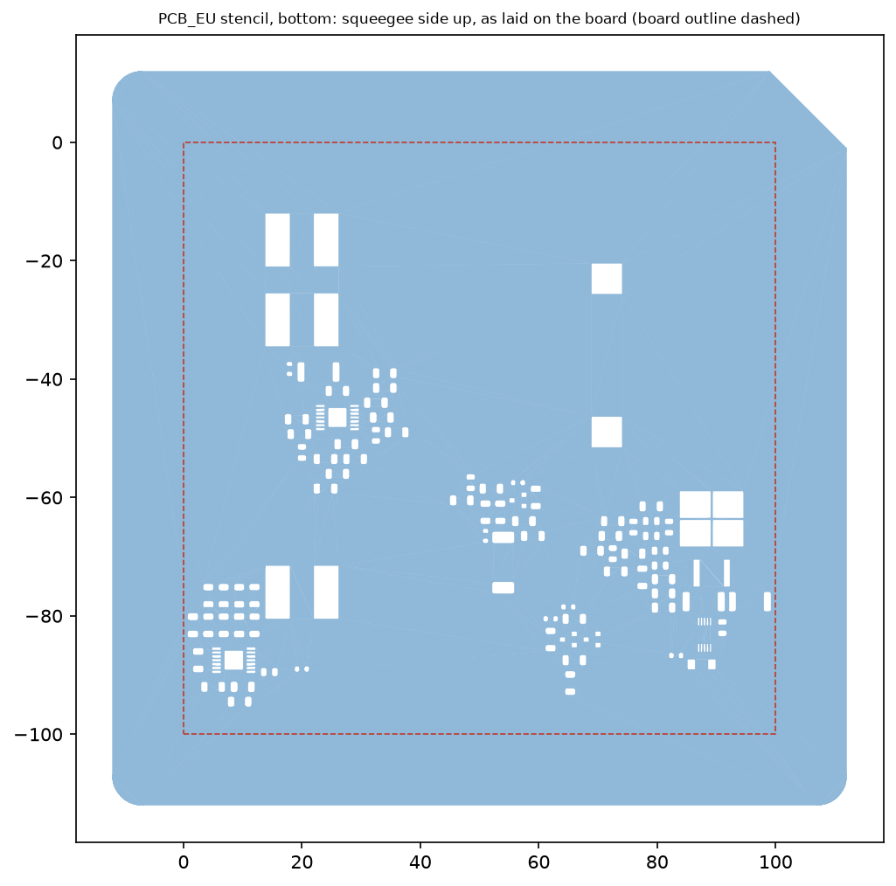

# Трафареты для паяльной пасты PCB_EU

Два печатных трафарета — **верхний** (F.Paste, 290 окон) и **нижний** (B.Paste, 205 окон) — для платы 100×100 мм, под сопло **0,2 мм**. Окна повторяют площадки пасты PCB, трафарет ложится на плату юбкой по её краю. **Не печатались и не проверялись на плате:** разрешение окон 0,3 мм и перемычек 0,2 мм на вашем принтере и посадку юбки нужно проверить на первом отпечатке (фрагмент-купон для этого есть).




На картинках трафарет показан со стороны ракеля, как он лежит на плате (красный пунктир — контур платы). Подпись «PCB_EU TOP 0.12» / «PCB_EU BOT 0.12» нанесена рельефом 0,48 мм на стороне платы, вне юбки; со стороны ракеля её не видно.

## Конструкция

- **Плёнка 0,12 мм** (2 слоя по 0,06). Окна пасты LM3429 в DESIGN.md рассчитаны на трафарет 0,125 мм. Размер 124×124 мм: по 12 мм за краем платы — место для пасты и хода ракеля.
- **Юбка** высотой 0,96 мм и толщиной стенки 1,2 мм (6 периметров) вокруг платы, зазор до края платы 0,15 мм на сторону. Юбка ниже платы (1,6 мм ±10 % — не меньше 1,44), поэтому плёнка опирается на плату, а не на стол.
- **Окна** — контуры площадок F.Paste / B.Paste из `PCB_EU.kicad_pcb` как их считает KiCad (с учётом окон пасты посадочных мест, без своих поправок). Все окна лежат внутри платы: ближайшие (R301, R807 сверху, C607 снизу) в 0,6–0,7 мм от её края, поэтому между окном и стенкой юбки остаётся не меньше 0,77 мм плёнки.
- **Сторона.** Нижний трафарет зеркален: плату переворачивают вокруг вертикальной оси, верх платы остаётся сверху.
- **Скошенный угол** плёнки — над углом платы x = 0, y = 0. У верхнего трафарета он слева сверху, у нижнего — справа сверху.
- Печатный вид: плёнка на столе стороной ракеля, юбка и подпись вверх, **поддержки не нужны** (вся высота 1,08 = 18 слоёв по 0,06 мм).

Расход пасты на одну сторону: верх 660 мм² × 0,12 мм ≈ 79 мм³, низ 705 мм² × 0,12 мм ≈ 85 мм³.

## Файлы

| Файл | Что это |
|---|---|
| `PCB_EU_stencil_top_print.stl`, `PCB_EU_stencil_bottom_print.stl` | Для печати, в печатной ориентации (плёнка на столе). Единицы — мм |
| `PCB_EU_stencil_coupon_print.stl` | Купон 12,3×15,9×0,12 мм: окна микросхемы U102 (VSSOP-10, шаг 0,5) с соседними. Печатать **первым** |
| `PCB_EU_stencil_top.png`, `PCB_EU_stencil_bottom.png` | Виды трафаретов в положении на плате |
| `apertures.json` | Контуры окон пасты, снятые с PCB (`export_apertures.py`); вход для `stencil.py` |
| `export_apertures.py` | Выгрузка окон из PCB; запускается Python из KiCad (нужен `pcbnew`) |
| `stencil.py` | Генератор. Все размеры — константы в начале файла |
| `check_stencil.py` | Проверки: правила окон, STL, сверка со STEP платы |
| `preview.py` | Рисунки для `stencil.py` |

Окна сняты с PCB из коммита `959f9b5`; от заказанной платы (`b3f286d`) она отличается только полем MPN двух конденсаторов, геометрия площадок и пасты та же. Экспорт сделан в KiCad 10.0.5, проект ориентирован на 10.0.7.

## Печать

- Сопло 0,2 мм, слой **0,06 мм (первый тоже 0,06)**, ширина линии 0,2–0,22 мм; 6 периметров, ≥ 2 нижних и верхних слоя, заполнение 100 % — плёнка из двух слоёв должна быть сплошной; без каймы (brim) и юбки слайсера у модели.
- **Перемычки 0,2 мм — одна линия экструзии.** Нужен режим тонких стенок (Arachne в PrusaSlicer/Orca, «Print Thin Walls» в Cura); без него перемычки пропадут и окна склеятся.
- Если окна 0,3 мм выходят уже расчётных, поправьте компенсацию отверстий в слайсере (горизонтальное расширение отверстий), а не модель: перемычки уже на пределе.
- Материал: PETG или PLA — не проверялось. Тонкую плёнку снимать со стола аккуратно, лучше гибкую пластину.

## Порядок первого запуска

1. Напечатать купон. Все 10 окон U102 должны быть сквозными, перемычки между ними целыми. Если нет — менять настройки слайсера, пока не получится: это самое тонкое место обоих трафаретов.
2. Напечатать оба трафарета.
3. Наложить трафарет на плату скошенным углом над углом x = 0, y = 0 (на виде сверху KiCad — левый верхний; нижняя сторона — после переворота вокруг вертикальной оси, угол справа сверху). Юбка охватывает плату, плёнка лежит на ней. Для надёжности зафиксировать лентой.
4. Когда пасту наносят на вторую сторону, плату кладут на опору с вырезами под уже припаянные детали первой стороны; опора в комплект не входит.

## Проверка

`python check_stencil.py` (нужен CadQuery 2.8.0, около двух минут):

| | верх | низ |
|---|---|---|
| Окон | 290 | 205 |
| Самое узкое окно | 0,40 мм (U101) | 0,30 мм (U102) |
| Самая тонкая перемычка | 0,25 мм (U101) | 0,20 мм (U102, U501, U601) |
| Площадь окна / площадь стенок (порог IPC-7525 0,66) | ≥ 1,37 | ≥ 1,06 |
| Ширина окна / толщина (порог 1,5) | ≥ 3,3 | ≥ 2,5 |

- Модели: одно валидное тело, по одному сквозному отверстию на окно, площадь отверстий равна площади окон; юбка не касается платы и стоит на 0,15 мм от её края. STL — закрытая ориентированная сетка, объём как у модели.
- **Совмещение с платой.** Центры окон готового трафарета в положении на плате сверяются с телами деталей в `review/PCB_EU_assembly.step` (экспорт KiCad, независимый от списка окон): над деталью своей стороны оказываются 100 % верхних окон (227 деталей) и 98,5 % нижних (139 деталей) в пределах 0,2 мм. Контроли: деталями другой стороны покрыто 34 % / 47 %, при неверном развороте (без зеркала у нижнего, зеркало у верхнего) — 27 % / 31 %. Три нижних окна — R803.2, R804.1 и R804.2 — в 0,5–0,64 мм от тела детали в STEP: тела R803 и R804 в сохранённой сборке стоят не там, где площадки PCB. Окна берутся из PCB, а не из STEP, поэтому на трафарет это не влияет; причину расхождения в STEP не выясняли.
- Ни одна деталь STEP не заходит в кольцо юбки.

Это геометрия по данным платы и 3D-моделям, а не проверка на реальной плате и принтере. Допуски печати, посадка юбки на плату с учётом реального контура и работа с пастой требуют проверки на первом отпечатке.

## Пересборка

```sh
python -m pip install cadquery==2.8.0 matplotlib
"C:/Program Files/KiCad/10.0/bin/python.exe" hardware/stencil/export_apertures.py   # только если изменилась PCB
python hardware/stencil/stencil.py
python hardware/stencil/check_stencil.py
```
